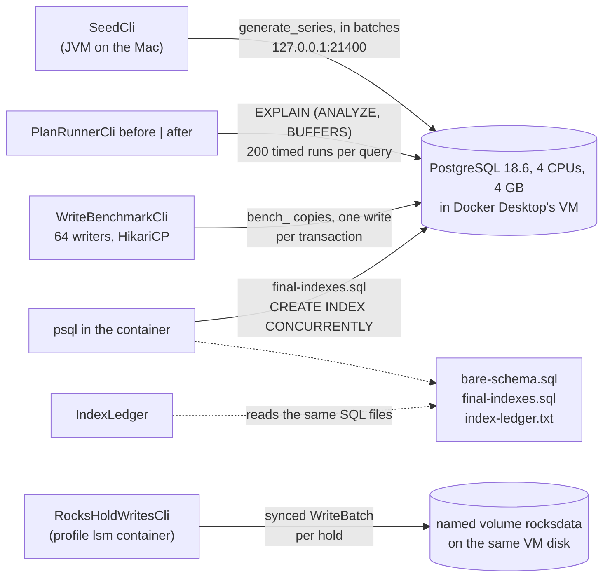

# Architecture

SeatWave's indexing study: Module 13's tables with their primary keys only, loaded with a quarter of the module's study volume; the five listed queries explained and timed before and after the final index set; the write cost of every index measured with 64 writers; and the same hold writes against RocksDB, an LSM store. This is the project of Module 14, "Indexes and storage engines", of the course System Design Fundamentals.

## Packages

All code is under `io.plainround.seatwave.indexes`.

| Package | What it holds | Needs a database |
|---|---|---|
| `catalog` | `ListedQuery` (Q1 to Q5 with their SQL, R1 to R6 for Module 13's rules) and `WriteStep` (the benchmark's ten steps: a table, its index DDL, its insert and its update) | no |
| `ledger` | `IndexLedger` (reads every index and its table from the schema files and checks them against `index-ledger.txt`), the sealed `LedgerProblem`, `IndexLedgerCli` | no |
| `study` | `StudySettings`, `SeedSql` and `SeedCli` (the load), `LatencySummary`, `PlanRunnerCli` (plans and timings), `WriteBenchmarkCli` | PostgreSQL, except `StudySettings` and `LatencySummary` |
| `model` | `BTree`, `LsmStore` and their demos: the two structures as small Java models that count pages and files | no |
| `estimate` | `StorageEstimateCli` and `WriteCostCli`: the module's estimates at full volume, from stated inputs | no |
| `lsm` | `RocksHoldWritesCli`: the hold writes against RocksDB | RocksDB's native library |
| `labs` | `ScanTypesCli` (Lab 1, reads a plan report) and `ColumnOrderCli` (Lab 2) | `ColumnOrderCli` only |

## The dependency rule

`catalog` depends on the JDK only; `ledger` on `catalog`; `study` and `labs` on `catalog` and the JDBC interfaces (the PostgreSQL driver is on the runtime classpath only); `lsm` on `study.LatencySummary` and `rocksdbjni`. `model` and `estimate` depend on nothing but the JDK. Only the `*Cli` classes print or exit. The SQL that builds the study lives in `src/main/resources/db/study/` and is read, not copied, by the seeder, the ledger check and the stack tests.

## Data flow

## Walk-through: the study

1. `scripts/stack.sh up --run --yes` writes three throwaway passwords into `.secrets/`, starts PostgreSQL and waits for its health check. `db/init/10-roles.sh` creates Module 13's two roles and `pg_stat_statements` once.
2. `./gradlew seed --args="--run --yes"` creates `seatwave_study` from `bare-schema.sql` (primary keys only), refuses a schema that already holds seats, loads every table with set-based statements in batches of 100 events, vacuums and analyzes each table, and checks every count.
3. `./gradlew plans --args=before` explains each study query once with `EXPLAIN (ANALYZE, BUFFERS, COSTS OFF)`, times it 200 times after one warm-up run, and lists every index with its size and scan count, into `build/study/plans-before.txt`.
4. `final-indexes.sql` is run by `psql` inside the container, one statement at a time with autocommit, because `CREATE INDEX CONCURRENTLY` cannot run in a transaction block.
5. `./gradlew plans --args=after` writes `plans-after.txt`; `./gradlew scanTypes` summarizes either file.
6. `./gradlew writeBenchmark` builds, for each `WriteStep`, a `bench_` copy of one study table with the step's indexes, prefills 1,000,000 rows, then lets 64 writers insert (and for the hold steps confirm) one row per transaction for 60 seconds per phase, and drops the copy.
7. `scripts/stack.sh rocks --run --yes` runs `RocksHoldWritesCli` three times in the profile-`lsm` container, so RocksDB writes to the same virtual disk with the same 4 CPUs.
8. `scripts/stack.sh down --run --yes` removes the containers, the network, both volumes and the passwords, and checks that nothing is left.

## Decisions and trade-offs

- **A quarter of the module's volume.** 12,625,000 seats, 15,000,000 holds and 10,000,000 bookings, about 7 GB with the final indexes, because Docker's disk is shared and must keep 20 GB free. Every ratio is kept (2,000 customers per arena event, so a customer has 8 bookings at any volume); the per-call costs of the indexed queries barely depend on the volume, and the full-scan costs scale with it, which the module states beside every number.
- **Indexes built concurrently, by `psql`.** The study applies `final-indexes.sql` exactly as production would, so the file is tested as it will be used.
- **The ledger reads the SQL, not a list.** `IndexLedger` takes index names and their tables from the schema files themselves, and a stack test proves that `pg_indexes` holds exactly those indexes on those tables. A ledger row must name a `WriteStep` that benchmarks the index's own table.
- **RocksDB in a container, not on the Mac.** On the Mac's disk a synced RocksDB write took the operating system's full flush (about 1,500 synced holds a second in a 3-second trial), which says nothing about RocksDB against PostgreSQL in the VM. The `rocks` service runs the same program on the VM's disk.
- **No embedded stand-in.** The subject is PostgreSQL's planner, B-tree and statistics; H2 has none of them. The tests that need PostgreSQL are tagged `stack` and run against the real image, outside `./gradlew check`.
- **`max_connections=200`.** The benchmark's pool holds 65 connections; PostgreSQL's default of 100, less 3 for superusers, left too little room beside it (Module 13 found the same).

## Invariants and where they are enforced

| Invariant | Enforced by | Proven by |
|---|---|---|
| Every index in the final schema has a ledger row, a listed user and a write cost measured on its own table | `IndexLedger.check`, run by `IndexLedgerTest` in `./gradlew check` | `IndexLedgerTest`, one test per kind of problem, each mutation-checked |
| The schema files and the database agree on every index and its table | `IndexLedger.indexTablesIn` | `StudySchemaStackTest.holdsExactlyTheIndexesTheLedgerChecksOnTheirTables` |
| Every benchmark step builds its indexes and its writes run | `WriteStep` | `StudySchemaStackTest.buildsEachBenchmarkStepsIndexesAndWritesItsRows`, ten cases |
| The seat map is served by indexes, never a table scan, after the final set | `final-indexes.sql` | `StudySchemaStackTest.answersTheSeatMapFromTheCoveringIndexAndTheClaimIndex` |
| A partial index serves only a query that repeats its predicate | PostgreSQL's planner | `StudySchemaStackTest.usesThePartialIndexOnlyWhenTheQueryRepeatsItsPredicate` |
| The seeder loads exactly the planned counts | `SeedCli.verify`, exit status 1 on any difference | `StudySchemaStackTest.loadsExactlyTheRowsTheSeedPlans` |
| Settings problems are reported together; the database is on `127.0.0.1`; the password never shows | `StudySettings.load` and `toString` | `StudySettingsTest` |
| Nothing of the project is left after a run | `scripts/stack.sh down` | its own check, and the listings in the README |
